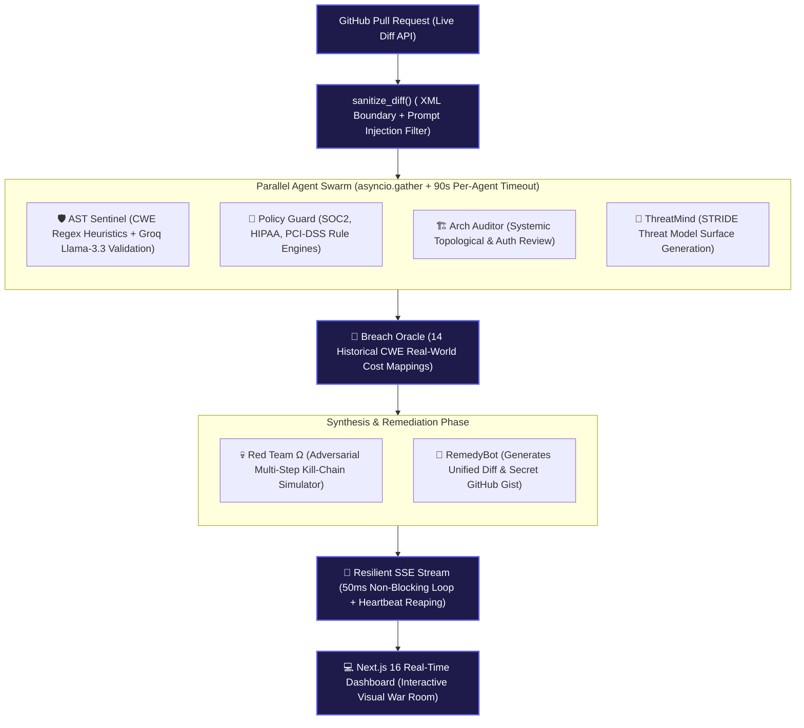

<div align="center">
  

  <h3>Autonomous Multi-Agent DevSecOps Intelligence</h3>

  <p>
    <b>ARGUS</b> is an autonomous multi-agent security orchestrator that fetches live GitHub pull requests, discovers real vulnerabilities, models business risk with historical breach costs, simulates adversarial kill chains, and writes verified remediation patches—in seconds.
  </p>

  <p>
    <a href="https://www.youtube.com/watch?v=3Yq6s_Rh3ys" target="_blank" rel="noopener noreferrer">
      
    </a>
  </p>

  <div>
    
    
    
    
    
    
  </div>
</div>

<br />

## 📖 Overview

Modern software development moves at breakneck speed, but traditional Static Application Security Testing (SAST) has failed to keep up. Legacy tools flood developers with noisy false positives, lack contextual understanding of architectural intent, and leave engineers guessing how to fix the vulnerabilities they flag.

**ARGUS replaces the legacy scanner with an autonomous multi-agent security team.**

Triggered directly against any public GitHub pull request or synthetic test diff, ARGUS dispatches 6 specialized AI agents running in parallel. The agents dissect syntax, audit compliance regulations, review high-level topology, model STRIDE threats, simulate multi-step adversarial kill chains, and generate ready-to-merge remediation patches in real time.

---

## ⚡ End-to-End Autonomous Pipeline

ARGUS processes pull requests through a defense-in-depth pipeline, isolating untrusted user input, fanning out analysis across specialized parallel agents, and streaming live telemetry to the web dashboard:



---

## ⚔️ Legacy SAST vs. ARGUS Autonomous Swarm

| Capability | Legacy SAST (SonarQube, Snyk, Checkmarx) | ARGUS Autonomous Swarm |
| :--- | :--- | :--- |
| **Speed & Throughput** | 10–45 minutes in CI/CD; stalls pull request merges | **15–30 seconds** via Groq LPUs (300+ tok/s) and parallel async task dispatch |
| **False Positive Rate** | **High (30%–60%)**; causes alert fatigue and ignored warnings | **Near-Zero**; static candidate hits undergo dual-stage LLM semantic verification |
| **Context Depth** | Superficial AST pattern matching on isolated lines | Holistic cross-file architectural review, STRIDE threat modeling & compliance audit |
| **Business Impact** | Abstract CVSS scores (e.g., *"7.5 High"*) | **Breach Oracle**: Maps flaws to real historical breaches, fines, and business loss |
| **Adversarial Simulation** | None; static list of isolated warnings | **Red Team Ω**: Simulates multi-step causal attack paths and privilege escalation chains |
| **Remediation** | Generic advice (e.g., *"sanitize input before query"*) | **RemedyBot**: Writes applicable unified diff patches and publishes secret GitHub Gists |

---

## 🤖 The 6-Agent Swarm

ARGUS coordinates 6 specialized autonomous agents, each engineered for a distinct security discipline:

| Agent | Designation | Core Capability |
| :--- | :--- | :--- |
| 🛡️ **AST Sentinel** | Vulnerability Scanner | Fast regex pattern heuristics cross-checked with semantic LLM validation to confirm low-level flaws (SQLi, XSS, exposed secrets). |
| 📜 **Policy Guard** | Compliance Auditor | Cross-references added code against strict regulatory articles (SOC2 CC6.1/6.6/6.7, HIPAA §164.312, PCI-DSS 6.3/8.2). |
| 🏗️ **Arch Auditor** | Architecture Reviewer | Scans structural design, unauthenticated endpoints, overly permissive CORS (`*`), and missing rate limiting. |
| 🎯 **ThreatMind** | Threat Modeler | Executes automated STRIDE threat modeling (Spoofing, Tampering, Repudiation, Info Disclosure, DoS, Elevation of Privilege). |
| 🔧 **RemedyBot** | Auto-Remediator | Synthesizes validated unified diff patches and creates private GitHub Gists ready for review and merge. |
| 💀 **Red Team Ω** | Exploit Engineer | Chains individual vulnerabilities into a realistic, multi-step adversarial kill chain demonstrating total breach impact. |

---

## 🛡️ Enterprise-Grade Defenses

<details>
<summary><b>1. XML Boundary Encapsulation & Prompt Injection Defense</b></summary>
<br>

All incoming diffs pass through `sanitize_diff()` before touching any AI agent:
* **Byte-Level Payload Cap**: Enforces a strict byte limit (`_DIFF_MAX_BYTES = 64KB`) to protect against token exhaustion.
* **Control Character Stripping**: Removes null bytes and terminal control escapes (`\x00-\x08`, `\x0b\x0c\x0e-\x1f`).
* **Injection Neutralization**: Known jailbreak phrases (e.g. `ignore all previous instructions`, `system prompt override`) are neutralized to `[ARGUS:INJECTION_NEUTRALISED]`.
* **XML Data Wrapper**: Diffs are enclosed in `<untrusted_diff>` data tags, with model instructions treating content purely as literal string data.
</details>

<details>
<summary><b>2. Resilient Server-Sent Events (SSE) Streaming Engine</b></summary>
<br>

Live telemetry is delivered via Server-Sent Events without polling:
* **Disconnect Reaping**: Detects client disconnection via `await request.is_disconnected()` every 50ms to instantly terminate orphaned agent runs and free server memory.
* **Non-Blocking Ring Buffer**: Event queues are maintained in-memory per `scan_id`, allowing client UI reconnection without loss of telemetry or logs.
* **Guaranteed Terminal Events**: Every scan terminates in an explicit `scan_complete` event containing risk scores, findings, or error descriptions.
</details>

<details>
<summary><b>3. Per-Agent Concurrency & Hard Timeout Isolation</b></summary>
<br>

External API hiccups or network delays never freeze the scan:
* Phase 1 agents execute concurrently via `asyncio.gather`.
* Each agent is wrapped in `_run_with_timeout` with a strict **90-second timeout guard** (`asyncio.wait_for`).
* If an agent fails or times out, surviving agents continue unimpeded, and the orchestrator aggregates partial results gracefully.
</details>

---

## 🔮 The Breach Oracle

Security reports often fail to motivate leadership because technical vulnerability codes mean little to non-technical stakeholders. 

ARGUS bridges this gap with the **Breach Oracle**—an integrated registry of historical real-world security breaches. When an agent identifies a confirmed vulnerability, the Oracle links it to historical precedent:

* **CWE-798 (Hardcoded Credentials)** ➔ *Twitch Source Leak (2021) — 125 GB source code & credentials leaked*
* **CWE-89 (SQL Injection)** ➔ *Heartland Payment Systems (2008) — 134M credit cards breached, $145M settlement*
* **CWE-94 (Code Injection)** ➔ *Equifax Data Breach (2017) — 147.9M consumer records, $575M FTC penalty*
* **CWE-532 (Sensitive Data in Logs)** ➔ *Change Healthcare / UnitedHealth (2024) — 100M+ ePHI patient records, $872M+ cost*
* **SOC2 CC6.1 Violation** ➔ *Capital One Cloud Breach (2019) — $80M OCC penalty + $190M settlement*

---

## ⚡ Quick Start Guide

Run ARGUS locally in under 3 minutes.

> **Prerequisites:** **[Node.js](https://nodejs.org/)** (v20+) and **[Python](https://www.python.org/)** (v3.11+ or v3.13) installed.

### Option A: Live GitHub PR Scanning (Recommended)

Scan any public GitHub pull request (e.g. `traceloop/openllmetry` PR #4618) with live AI inference:

```bash
# 1. Clone the repository
git clone https://github.com/manojmulammagari/argus.git
cd argus

# 2. Configure environment
cp .env.example backend/.env
# Edit backend/.env and add your GROQ_API_KEY and GITHUB_TOKEN

# 3. Start the Backend API (:8000)
cd backend
python -m venv venv
# Windows:
.\venv\Scripts\activate
# Linux/macOS:
# source venv/bin/activate
pip install -r requirements.txt
uvicorn main_api:app --reload --port 8000

# 4. In a second terminal, start the Next.js Dashboard (:3000)
cd ../frontend
npm install
npm run dev
```

Open **`http://localhost:3000`**, enter any GitHub repository (`owner/repo`) and PR number, and click **"Start ARGUS Scan"**.

---

### Option B: Zero-Key Instant Demo Mode

Evaluate ARGUS with zero credentials, zero configuration, and zero API signups:

```bash
# 1. Start backend in Demo Mode
cd backend
python -m venv venv
.\venv\Scripts\activate
pip install -r requirements.txt
uvicorn main_api:app --reload --port 8000

# 2. Start frontend
cd ../frontend
npm install
npm run dev
```

Open **`http://localhost:3000`** and click **"Launch Live Demo"** (or scan `demo/vulnerable-app` PR #42). ARGUS executes the full 6-agent swarm against a bundled synthetic vulnerability diff.

---

## 🔑 Environment Variables

Configure these variables in `backend/.env`:

| Variable | Description | Required | Default |
| :--- | :--- | :---: | :--- |
| `GROQ_API_KEY` | Primary LLM inference key ([console.groq.com](https://console.groq.com)) — Free tier, 300+ tok/s | Optional* | None |
| `GEMINI_API_KEY` | Secondary / fallback LLM key ([aistudio.google.com](https://aistudio.google.com)) | Optional* | None |
| `GITHUB_TOKEN` | Personal Access Token with `gist` scope for live PR fetching & private Gist creation | Optional | None |
| `DEMO_MODE` | Force synthetic demo diff scanning (`true` / `false`) | Optional | `false` |
| `PORT` | Backend HTTP port | Optional | `8000` |
| `ALLOWED_ORIGINS` | Comma-separated CORS allowed origins | Optional | `http://localhost:3000,http://127.0.0.1:3000` |
| `NEXT_PUBLIC_API_URL` | Backend URL configured in frontend client requests | Optional | `http://localhost:8000` |

*\*If no LLM keys are supplied, ARGUS automatically operates in degraded zero-key demo mode.*

---

## 📡 API & Streaming Contract

| Method | Endpoint | Description |
| :--- | :--- | :--- |
| `POST` | `/api/scan` | Initiates an autonomous scan (`repo`, `pr_number`) |
| `POST` | `/api/demo` | Alias endpoint for starting scans |
| `GET` | `/api/stream/{scan_id}` | Real-time Server-Sent Events (SSE) telemetry stream |
| `GET` | `/api/scans` | Lists recent scans in memory (bounded by 1-hour TTL) |
| `GET` | `/api/scans/{scan_id}` | Retrieves scan metadata, findings, and kill chain |
| `POST` | `/api/scans/{scan_id}/approve` | Human-in-the-loop remediation approval |
| `GET` | `/health` | Service healthcheck & LLM provider status |

---

## ⚖️ Architecture Decisions

* **Bounded In-Memory State**: Scans are stored in memory with timezone-safe UTC timestamps and evicted automatically after 1 hour via `_evict_old_scans()`. Admission control enforces a hard limit of `_MAX_CONCURRENT_SCANS = 5` with 429 backoff, protecting system resources without requiring heavy external databases.
* **Provider Redundancy**: Groq (Llama 3.3 70B) is utilized as the high-velocity primary inference engine, with Google Gemini 2.0 Flash serving as an automated fallback if rate limits or network resets occur.
* **Deterministic Remediation**: Live PR fixes are published as private GitHub Gists with unified diff previews, ensuring human developers review and approve all proposed code before merging.

<br />

<div align="center">
  <i>Engineered for the future of autonomous, developer-first security.</i>
</div>
