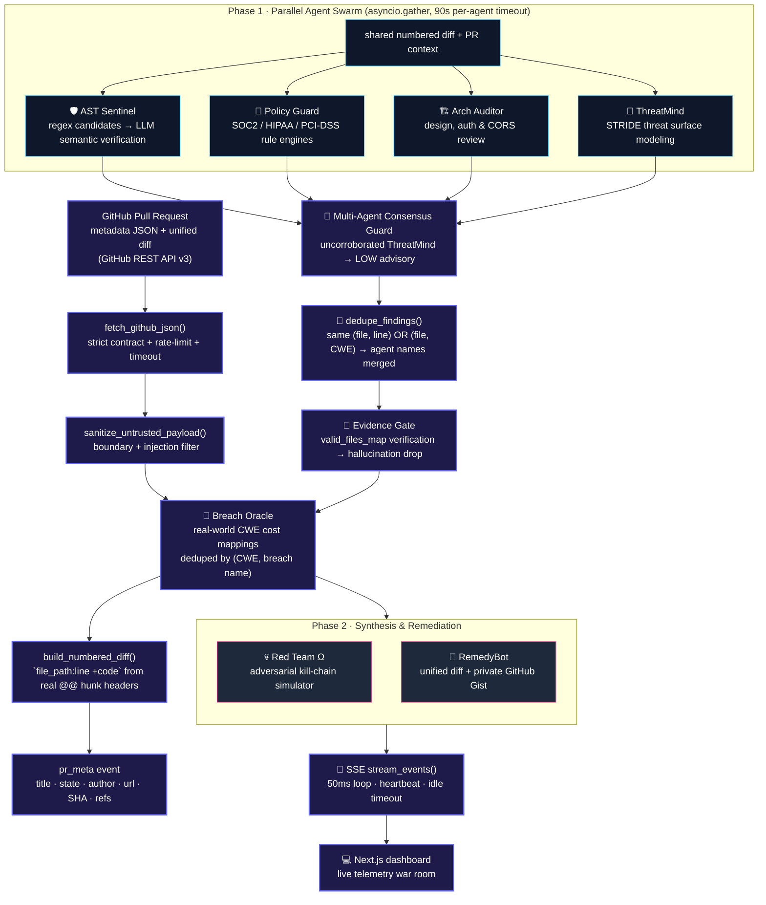

<div align="center">
  <h1>🛡️ ARGUS</h1>
  <h3>Autonomous Multi-Agent DevSecOps Intelligence</h3>

  <p>
    <b>ARGUS</b> is an autonomous multi-agent security orchestrator that fetches live GitHub pull requests,
    discovers <b>real</b> vulnerabilities with <b>zero hallucinations</b>, models business risk with historical
    breach costs, simulates adversarial kill chains, and writes verified remediation patches — in seconds.
  </p>

  <div>
    
    
    
    
    
    
  </div>

  <p>
    <a href="docs/ARCHITECTURE.md"><b>📐 Architecture</b></a> ·
    <a href="docs/DEMO_SCRIPT.md"><b>🎬 3-Minute Demo Script</b></a> ·
    <a href="SECURITY.md"><b>🔒 Security Policy</b></a> ·
    <a href="CONTRIBUTING.md"><b>🤝 Contributing</b></a>
  </p>
</div>

<br />

## 📖 Overview

Modern software ships at breakneck speed, but traditional Static Application Security Testing (SAST) has not kept up.
Legacy tools flood developers with noisy false positives, lack architectural context, and leave engineers guessing how
to fix what they flag.

**ARGUS replaces the legacy scanner with an autonomous multi-agent security team.**

Triggered against any public GitHub pull request — or a bundled synthetic diff — ARGUS dispatches six specialized AI
agents that dissect syntax, audit compliance, review architecture, model STRIDE threats, simulate multi-step adversarial
kill chains, and generate ready-to-merge patches in real time, streaming every step to a live dashboard over
Server-Sent Events.

> **📚 New to the codebase?** Start with **[`docs/ARCHITECTURE.md`](docs/ARCHITECTURE.md)** for a file-by-file,
> function-by-function walkthrough. To record the pitch, use **[`docs/DEMO_SCRIPT.md`](docs/DEMO_SCRIPT.md)**.

---

## 🔒 Zero False Positives on Merged & Clean PRs

ARGUS is engineered to eliminate the #1 complaint developers have with security tooling: false positives on safe,
already-merged, or security-fix pull requests.

### Deterministic Evidence Gate (Zero-Fake-Code Policy)

Every finding reported by any LLM agent is programmatically verified **before** it ever reaches the dashboard:

| Gate Rule | Action |
|:----------|:-------|
| **File must exist in the PR diff** | Findings referencing non-existent file paths are dropped |
| **Line must be an added (`+`) line** | Removed (`-`) lines never appear in the valid-files index — a PR that removes a hardcoded secret and replaces it with safe code is scored as a **security fix (0 findings)**, not a false positive |
| **Code snippet must match verbatim** | Any hallucinated snippet is overwritten with the exact line text extracted directly from the real GitHub unified diff |
| **Cross-agent dedupe** | Findings sharing `(file_path, line_number)` or `(file_path, cwe_id)` collapse into one card listing every detector |

> *"CRITICAL RULE: You may ONLY report vulnerabilities introduced in ADDED lines (`+`). You MUST quote the exact `code_snippet` verbatim from the provided diff. Do NOT invent code. If a PR fixes a bug, updates docs/tests, or contains safe idiomatic code, you MUST return an empty `findings: []` array. Returning 0 findings on safe code is expected and rewarded."*

This means scanning real clean/merged PRs (e.g. `traceloop/openllmetry #4618`) or intentional training repos (`OWASP/wrongsecrets #951`) yields **accurate scores, not hallucinated vulnerabilities**.

---

## ⚡ End-to-End Autonomous Pipeline

ARGUS processes pull requests through a defense-in-depth pipeline: it isolates untrusted input, fans analysis out across
specialized parallel agents, then synthesizes remediation and streams live telemetry to the dashboard.



---

## 🏗️ flowdesk Real-Time DAG Telemetry

Every scan emits structured `flowdesk` telemetry in each SSE event and REST response, giving full step-level observability:

```json
{
  "active_node": "FLOW_COMPLETE",
  "completed_nodes": [
    "FLOW_INIT", "GITHUB_INGEST", "DIFF_AST_INDEXING", "XML_SANITIZATION",
    "PARALLEL_SWARM", "EVIDENCE_GATE", "BREACH_ORACLE", "REMEDY_SYNTHESIS"
  ],
  "step_durations_ms": { "GITHUB_INGEST": 842.5, "PARALLEL_SWARM": 4210.3 },
  "agent_states": {
    "ast_sentinel": "VERIFIED_CLEAN",
    "policy_guard": "VERIFIED_CLEAN",
    "arch_auditor": "VERIFIED_CLEAN",
    "threat_mind": "DEGRADED",
    "remedy_bot": "COMPLETE",
    "red_team": "COMPLETE"
  },
  "llm_provider_used": "groq-70b",
  "tokens_processed": 12450,
  "filtered_hallucinations_count": 3,
  "meta": {
    "rate_limit_remaining": "4992",
    "pages_fetched": 1,
    "ignored_lockfiles_count": 4,
    "diff_ignored_lockfiles": 0,
    "diff_truncated": false,
    "diff_total_files": 12
  }
}
```

**Flow states:** `INITIALIZING → FETCHING_PR → FILTERING_DIFF → XML_SANITIZATION → PARALLEL_SWARM → EVIDENCE_GATE → BREACH_ORACLE → REMEDY_SYNTHESIS → COMPLETE` (or `DEGRADED` / `ERROR`).

---

## 🤖 The 6-Agent Swarm

| Agent | Designation | Core capability |
|:---|:---|:---|
| 🛡️ **AST Sentinel** | Vulnerability Scanner | Regex heuristics (CWE-798/89/532/327/287) served as unverified candidates; every finding confirmed by LLM against numbered added lines |
| 📜 **Policy Guard** | Compliance Auditor | Cross-references added lines against SOC2 CC6.1/6.6/6.7, HIPAA §164.312, PCI-DSS 6.3/8.2/4.2, resolving each control to a concrete CWE |
| 🏗️ **Arch Auditor** | Architecture Reviewer | Detects missing auth, permissive CORS (`*`), missing rate limiting, unauthenticated endpoints, secrets in build artifacts |
| 🎯 **ThreatMind** | Threat Modeler | Automated STRIDE modeling (Spoofing, Tampering, Repudiation, Info Disclosure, DoS, Elevation of Privilege) |
| 🔧 **RemedyBot** | Auto-Remediator | Synthesizes syntactically valid unified-diff patches targeting exact PR files; publishes as private GitHub Gist |
| 💀 **Red Team Ω** | Exploit Engineer | Chains confirmed findings into a 4–6 step adversarial kill chain demonstrating total breach impact |

Every agent inspects the same **numbered diff** — each added line rendered as `file_path:line +code` using real `@@` hunk line numbers — alongside live PR title, description, state, author, and GitHub metadata. Agents distinguish *introducing* a vulnerability from *fixing* a bug, adding tests, or refactoring, returning `"findings": []` for benign changes. Each agent streams an `analysis_trace` of the files and lines it actually inspected.

### 3-Tier LLM Cascade + Deterministic Fallback

For resilience, every agent executes through a tiered cascade:

1. **Tier 1:** Groq `llama-3.3-70b-versatile` — `asyncio.Semaphore(2)`, 3-attempt exponential backoff (`1.5s` / `3.0s` / `5.0s` + jitter) on HTTP `429`/`503`
2. **Tier 2:** Groq `llama-3.1-8b-instant` — high-throughput burst fallback
3. **Tier 3:** Google Gemini (`gemini-2.0-flash` → `gemini-1.5-flash`) — direct async HTTP with `responseMimeType: "application/json"`
4. **Tier 4 (Zero Silent Failure):** If all LLM tiers fail, the agent is marked `DEGRADED` and a deterministic AST/regex static scanner runs strictly on added (`+`) lines, so unreachable LLMs can never be mistaken for a clean PR

---

## ⚖️ Legacy SAST vs. ARGUS Autonomous Swarm

| Capability | Legacy SAST (SonarQube, Snyk, Checkmarx) | ARGUS Autonomous Swarm |
|:---|:---|:---|
| **Speed & throughput** | 10–45 minutes in CI/CD; stalls merges | **15–30 seconds** on Groq LPUs with parallel async dispatch |
| **False positive rate** | **High (30–60%)** → alert fatigue | **Near-zero** — Evidence Gate drops non-existent files/removed-line/hallucinated-snippet findings; consensus guard suppresses uncorroborated guesses |
| **Context depth** | Superficial line-level pattern matching | Cross-file architectural review, STRIDE modeling, compliance audit |
| **Business impact** | Abstract CVSS scores (*"7.5 High"*) | **Breach Oracle** — maps flaws to real breaches, fines, and business loss |
| **Adversarial simulation** | None — isolated warnings | **Red Team Ω** — multi-step causal attack and privilege-escalation chains |
| **Remediation** | Generic advice (*"sanitize input"*) | **RemedyBot** — applicable unified diffs published as private GitHub Gists |
| **Fix-vs-vuln distinction** | Often flags security fixes as new bugs | Removed (`-`) lines are never flagged — security fixes score `0` findings |

---

## 🤝 Multi-Agent Consensus & Risk Scoring

The single biggest reason developers ignore security tooling is false positives. ARGUS is built around a **corroboration rule**:

> If **AST Sentinel**, **Policy Guard**, and **Arch Auditor** all return **zero** findings, a solo speculative finding from **ThreatMind** cannot block the merge. It is downgraded to a **LOW advisory**, its breach citation is dropped, and the risk score is capped at **≤ 15/100 (`SECURITY CHECK PASSED`)**.

The consensus-damped risk score:

| Condition | Score band | Verdict |
|:---|:---|:---|
| Uncorroborated ThreatMind finding only | `min(raw, 15)` | 🟢 `SECURITY CHECK PASSED` |
| Any confirmed `CRITICAL` / `HIGH` | `clamp(raw, 75, 95)` | 🔴 `CRITICAL VULNERABILITIES FOUND` |
| A single low/medium finding | `min(raw, 20)` | 🟢 `SECURITY CHECK PASSED` |
| A few medium findings | `min(raw, 45)` | 🟠 `SECURITY REVIEW ADVISED` |

Weights: `critical = 25`, `high = 15`, `medium = 8`, `low = 3`.

**Cross-agent dedupe** (`dedupe_findings()`) collapses findings that share `(file_path, line_number)` or `(file_path, cwe_id)` into one card whose agent badge lists every detector (e.g. `AST Sentinel + Policy Guard`). Dedupe runs before risk scoring and RemedyBot.

---

## 🔮 The Breach Oracle

Security reports fail to motivate leadership because vulnerability codes mean little to non-technical stakeholders. ARGUS bridges that gap with the **Breach Oracle** — a registry of real-world breaches and their financial consequences:

| CWE | Breach | Scale | Cost |
|:---|:---|:---|:---|
| CWE-798 | Twitch Source Leak (2021) | 125 GB source & history | Brand & executive churn |
| CWE-89 | TalkTalk / Heartland | 134M cards | $145M settlement |
| CWE-94 | Equifax (2017) | 147.9M records | $575M FTC penalty |
| CWE-532 | Change Healthcare / UnitedHealth | 100M+ ePHI | $872M+ remediation |
| CWE-200 | Facebook / Cambridge Analytica | 87M profiles | $5B FTC fine |
| CWE-319 | Marriott / Starwood | 383M records | $52M + $124M |
| SOC2 CC6.1 | Capital One Cloud Breach | 106M applications | $80M + $190M |

Oracle entries are **deduplicated by `(cwe_id, breach name)`** and every entry renders a valid **CWE badge**.

---

## ⚡ Quick Start

> **Prerequisites:** [Node.js](https://nodejs.org/) **v20+** and [Python](https://www.python.org/) **v3.11+**.

### Option A — Live GitHub PR scanning (recommended)

```bash
# 1. Clone
git clone https://github.com/manojmulammagari/argus.git
cd argus

# 2. Configure the backend
cp .env.example backend/.env
# Edit backend/.env — add GROQ_API_KEY (required for live inference)
# and GITHUB_TOKEN (required for live PR fetching + private Gists)

# 3. Start the backend API (:8000)
cd backend
python -m venv venv
.\venv\Scripts\activate          # macOS/Linux: source venv/bin/activate
pip install -r requirements.txt
uvicorn main_api:app --reload --host 0.0.0.0 --port 8000

# 4. In a second terminal, start the dashboard (:3000)
cd ../frontend
npm install
npm run dev
```

Open **`http://localhost:3000`**, enter `owner/repo` + PR number (or click a suggestion chip like `traceloop/openllmetry #4618`), and press **Scan Pull Request**.

> `GITHUB_TOKEN` is optional but recommended: it raises the GitHub API rate limit and is required to publish the remediation Gist. ARGUS makes authenticated GitHub API calls per scan — PR metadata and the raw unified diff — with strict timeouts, rate-limit awareness, pagination, and graceful 404 handling.

### Option B — Zero-key instant demo mode

No API keys, no signups:

```bash
cd backend
python -m venv venv && .\venv\Scripts\activate    # macOS/Linux: source venv/bin/activate
pip install -r requirements.txt
uvicorn main_api:app --reload --port 8000

# second terminal
cd ../frontend && npm install && npm run dev
```

Open **`http://localhost:3000`**, scan **`demo/vulnerable-app`** PR **#42**, and watch the swarm run against the bundled synthetic diff. With no LLM keys — or when the engines are rate-limited — ARGUS degrades safely rather than reporting a false clean: agents surface an explicit "engines unavailable" warning, so an unreachable LLM can never be mistaken for a clean PR.

---

## 🔑 Environment Variables

Configure these in `backend/.env` (see `.env.example`):

| Variable | Description | Required | Default |
|:---|:---|:---:|:---|
| `GROQ_API_KEY` | Primary inference key ([console.groq.com](https://console.groq.com/keys)) — free tier | Optional\* | — |
| `GEMINI_API_KEY` | Fallback inference key ([aistudio.google.com](https://aistudio.google.com/apikey)) | Optional\* | — |
| `GROQ_MODEL` | Primary model id | Optional | `llama-3.3-70b-versatile` |
| `GEMINI_MODEL` | Fallback model id | Optional | `gemini-2.0-flash` |
| `GITHUB_TOKEN` | PAT with **`gist`** scope — live PR fetching & private Gist creation | Optional | — |
| `GH_TOKEN` | Alternate GitHub PAT name | Optional | — |
| `DEMO_MODE` | Force synthetic demo diff, skip Gist creation (`true`/`false`) | Optional | `false` |
| `PORT` | Backend HTTP port | Optional | `8000` |
| `ALLOWED_ORIGINS` | Comma-separated CORS allow-list | Optional | `http://localhost:3000,http://127.0.0.1:3000` |
| `NEXT_PUBLIC_API_URL` | Backend base URL used by the frontend client | Optional | `http://localhost:8000` |

\*With **no** LLM keys — or when both providers fail at runtime — ARGUS degrades to deterministic heuristics instead of failing or reporting a false clean scan.

---

## 📡 API & Streaming Contract

| Method | Endpoint | Description |
|:---|:---|:---|
| `POST` | `/api/scan` \| `/api/demo` \| `/api/scan/start` | Start a scan (`{repo, pr_number}`) → `{scan_id}` |
| `GET` | `/api/stream/{scan_id}` | Real-time SSE telemetry stream |
| `GET` | `/api/scans` | Recent scans (bounded by the 1-hour TTL) |
| `GET` | `/api/scans/{scan_id}` | Scan metadata, findings, breach oracle, kill chain |
| `POST` | `/api/scans/{scan_id}/approve` | Human-in-the-loop remediation approval |
| `GET` | `/health` | Healthcheck + LLM provider status |

**SSE event types:** `status`, `pr_meta`, `trace`, `finding`, `scan_complete`, `done`, `timeout`, `remediation_ready`, `remediation_approved` (plus `: heartbeat` comments). The initial `status`/`pr_meta` pair carries the real PR title, GitHub state (`OPEN`/`MERGED`/`CLOSED`), author, and URL before any agent starts.

**Finding shape:** `{id, agent, title, severity (CRITICAL\|HIGH\|MEDIUM\|LOW), cwe_id, file_path, line_number, code_snippet, description, remediation, compliance_refs, breach_citation}` — guaranteed render-safe by `normalize_finding()` and cross-agent deduped by `dedupe_findings()`.

---

## 🧪 Testing & CI

```bash
# Backend — deterministic, offline, no network calls
cd backend && pytest -q

# Frontend — type check + production build
cd frontend && npm run lint && npm run build
```

CI (`.github/workflows/ci.yml`) runs the backend suite on Python 3.13 and `npm ci` → type check → production build on Node 20.

### Edge-case verification suite

A standalone verification script exercises:
1. **Non-existent PR (404)** → structured error dict, zero `'str' object has no attribute 'get'` crashes
2. **Malformed / non-dict LLM output** → fallback, zero `.get()` crashes
3. **Lockfile filtering & diff line-number indexing** → only real `+` lines are flagged
4. **Strict contract return types** → every GitHub fetch returns a predictable dictionary schema

---

## 🛡️ Enterprise-Grade Defenses

<details>
<summary><b>1. XML Boundary Encapsulation & Prompt-Injection Defense</b></summary>
<br>

Every incoming diff passes through `sanitize_untrusted_payload()` before touching any AI agent:
* **Byte-level payload cap** — `_DIFF_MAX_BYTES = 64 KB`, protecting against token exhaustion
* **Control-character stripping** — removes null bytes and terminal escapes
* **Injection neutralization** — known jailbreak phrasing becomes `[ARGUS:INJECTION_NEUTRALISED]`
* **XML data wrapper** — the diff is enclosed in an `<untrusted_diff>` boundary treated as literal data
* **Numbered rendering** — `build_numbered_diff()` renders every added line as `file_path:line +code` using real `@@` hunk line numbers, capped at 8,000 characters per agent prompt

</details>

<details>
<summary><b>2. Resilient Server-Sent Events (SSE) Streaming Engine</b></summary>
<br>

* **Disconnect reaping** — `request.is_disconnected()` checked every 50 ms
* **Non-blocking event buffer** — per-`scan_id` event queues allow reconnection without losing telemetry
* **Heartbeats** — `: heartbeat` comment every ~10 s keeps proxies from closing idle streams
* **Guaranteed terminal events** — every scan ends with an explicit `scan_complete` (or `done` / `timeout`) event

</details>

<details>
<summary><b>3. Per-Agent Concurrency & Hard Timeout Isolation</b></summary>
<br>

* Phase-1 agents run concurrently via `asyncio.gather`
* Each agent wrapped in `_run_with_timeout` with a strict **90-second** `asyncio.wait_for` guard
* A failed or timed-out agent returns an empty result; the orchestrator aggregates partial results and never hangs the pipeline

</details>

<details>
<summary><b>4. Admission Control & Bounded Memory</b></summary>
<br>

* `_MAX_CONCURRENT_SCANS = 3` with a 5-second start cooldown → `429` with a human-readable message
* Scans stored in memory with timezone-safe UTC epoch timestamps, evicted after **1 hour** by `_evict_old_scans()`

</details>

---

## 📐 Architecture Decisions

* **Bounded in-memory state over a database.** Scans live in a module-level dict with timezone-safe UTC timestamps and a 1-hour TTL, so the demo is dependency-free. `DATABASE_URL` / `REDIS_URL` are read for a future durable/Redis-backed deployment.
* **Provider redundancy.** Groq is the high-velocity primary engine; Google Gemini is the automatic fallback on rate limit or network reset. Both reply shapes (tool calls *and* plain JSON content) are accepted.
* **Corroboration over speculation.** A single uncorroborated agent cannot block a merge — the mechanism that keeps a clean PR in the `SECURITY CHECK PASSED` band.
* **Deterministic remediation guarantee.** If the LLM does not return a valid unified diff, RemedyBot synthesizes one from the added lines, so a patch is always available for review.
* **Unbounded-growth guard.** `emit()` and `add_finding()` use `SCANS.get(...)` guards, so eviction mid-scan can never raise.

<br />

<div align="center">
  <i>Engineered for the future of autonomous, developer-first security.</i>
</div>
